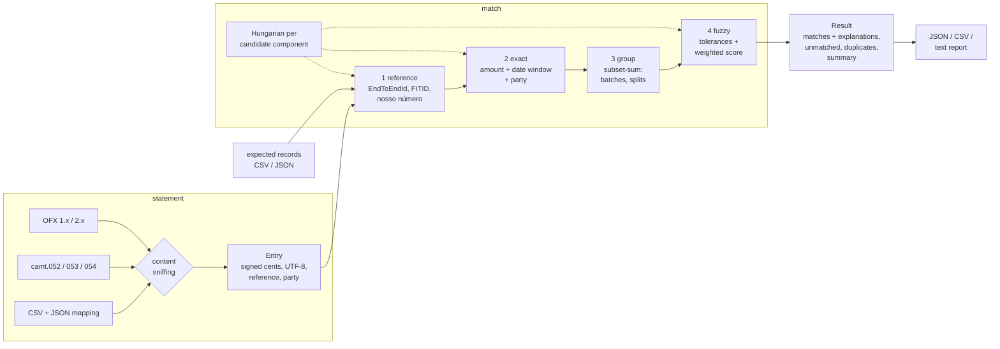

# reconcile-go

[](https://github.com/victorcondackdev/reconcile-go/actions/workflows/ci.yml)
[](https://pkg.go.dev/github.com/victorcondackdev/reconcile-go)

Bank statement reconciliation for finance and payments operations, as a
zero-dependency Go library and CLI. It parses statements from banks and PSPs
(OFX, ISO 20022 camt, CSV exports) into one normalized model and matches them
against what your ledger or order system expects to receive and pay. Every
match comes with a confidence score and the evidence behind it.

```sh
reconcile run --statement extrato.ofx --expected pedidos.csv \
              --mapping mapping.json --config rules.json --details
```

```
M0007 group     0.84  entry 202611180002 396.15 <- expected PED-1004+PED-1005+PED-1006 405.85
      one entry settles 3 expected records (rule pagfacil-credit): gross 405.85, net 396.15, difference -9.70 (2.39%)
      - rule         pagfacil-credit
      - sum          3 records totalling 405.85; entry 396.15
      - fee          9.70 withheld (2.39% of gross; rule rate 2.39%)
      - date         all expected on the same date, -1 day relative to entry
```

## Why

Reconciliation is where payment systems meet the real world. Banks drop
references, acquirers pay a day of card sales as one credit net of fees,
customers split a Pix in two or pay two orders at once, statement exports
duplicate lines and print names truncated and without accents. A matcher
that only compares amounts and dates either misses most of this or matches
the wrong things with confidence.

- **Evidence first.** Passes run from the strongest evidence (an identifier
  echoed by the bank) to the weakest (a scored fuzzy candidate). A record
  matched by a strong pass is never reconsidered by a weaker one.
- **Groups, not only pairs.** Many-to-one settlements and one-to-many split
  payments are found by a bounded subset-sum search that understands fees.
- **Globally optimal pairing.** Competing candidates are resolved with the
  Hungarian algorithm, so one greedy early choice cannot strand the rest.
- **Explainable and deterministic.** Each match carries the rule that fired
  and every feature that contributed. The same input and configuration
  always give the same output, byte for byte.
- **Exact money.** Amounts are signed `int64` cents end to end, parsed from
  text without floating point.
- **Brazilian reality built in.** `1.234,56` amounts, `dd/mm/yyyy` dates,
  Windows-1252 OFX files (and the ones that claim to be but are UTF-8),
  `[-3:BRT]` offsets, Pix EndToEndId extraction, boleto "nosso número"
  with inconsistent zero padding.
- **Standard library only.** No dependencies, Go 1.22+.

## Pipeline



## Install

```sh
go get github.com/victorcondackdev/reconcile-go
go install github.com/victorcondackdev/reconcile-go/cmd/reconcile@latest
go install github.com/victorcondackdev/reconcile-go/cmd/gen-dataset@latest
```

## Supported formats

| Format | Versions | Notes |
|---|---|---|
| OFX 1.x | 1.02, 1.03, 1.6 (SGML) | Unclosed leaf tags, missing `</STMTTRN>`, `CHARSET:1252`/`ISO-8859-1` converted to UTF-8, mislabelled UTF-8 bodies detected, `TRNAMT` with `,` decimals, `STMTRS` and `CCSTMTRS`, `LEDGERBAL`/`AVAILBAL`, `PAYEE`, `CURRENCY/CURSYM` |
| OFX 2.x | 2.0 to 2.2 (XML) | Same tolerant scanner; encoding from the XML declaration; entities |
| camt.053 | any `.001.xx` | `BkToCstmrStmt`; `Sts` and `Sts/Cd`; `Dbtr/Nm` and `Dbtr/Pty/Nm`; `EndToEndId` (`NOTPROVIDED` ignored), `CdtrRefInf/Ref`, `TxId`; balances |
| camt.054 | any `.001.xx` | `BkToCstmrDbtCdtNtfctn`; batch entries kept whole or split per `TxDtls` |
| camt.052 | any `.001.xx` | `BkToCstmrAcctRpt` |
| CSV | any bank export | JSON mapping: delimiter (or sniffed), encoding, banner rows, `1.234,56` or `1,234.56`, `R$`, `(neg)`, trailing `D`/`C`/`-`, amount or credit/debit columns or a D/C indicator, date patterns (`dd/mm/yyyy`), rows to skip by description; header guessing for common pt-BR/en names |

Dates keep the offset found in the file (`20261121233000[-3:BRT]` is booked
on the 21st even though it is the 22nd in UTC); matching compares calendar
days in that offset.

```go
st, err := statement.Parse(f) // format detected from content
for _, e := range st.Entries {
    fmt.Println(e.ID, e.BookingDate, e.AmountCents, e.Reference, e.Description)
}
```

A CSV mapping (the `statement` half of `mapping.json`):

```json
{
  "delimiter": ";",
  "skip_rows": 2,
  "decimal_separator": ",",
  "thousands_separator": ".",
  "date_format": "dd/mm/yyyy",
  "columns": {"booking_date": "Data", "id": "Documento", "description": "Histórico",
              "amount": "Valor (R$)", "direction": "D/C"},
  "debit_values": ["D"],
  "skip_descriptions": ["SALDO DO DIA", "SALDO ANTERIOR"]
}
```

## Matching passes

Each pass only sees what the previous passes left unmatched.

| Pass | Evidence | Typical case | Confidence |
|---|---|---|---|
| 1. reference | statement `Reference`, `ID` or a description token equals the expected `Reference` or `ID` after removing punctuation and leading zeros | Pix EndToEndId, boleto nosso número, document number in the memo | 0.94 to 0.99; lower when amounts differ (up to 50% accepted, difference reported) |
| 2. exact | same amount to the cent, dates within `date_window_days`, party names not contradicting (`min_counterparty_similarity`) | TED and Pix without reference, supplier payments | 0.80 to 0.98 |
| 3. group | bounded subset-sum search, see below | acquirer batch net of MDR, two orders in one Pix, one order paid in parts | 0.30 to 0.90; lowered for larger groups, ambiguity and budget exhaustion |
| 4. fuzzy | weighted score over amount closeness, date closeness, party similarity and description similarity, within tolerances | boleto credited net of a bank fee, late payment, typo in the payer name | 0.9 x score |

**Group rules** describe settlements: which entries they apply to (`match`
on the description), which expected records they may combine (`tag`), the
fee withheld (`fee_min_percent`..`fee_max_percent` of the gross, plus
`fee_fixed_cents` per record, give or take `tolerance_cents` per record),
whether all records must share one sale date (`same_date`) and the minimum
settlement lag (`min_lag_days`). The default rule set only contains
`combined-payment` (exact sum, same party); acquirer rules are yours to
declare:

```json
{
  "group": {
    "rules": [
      {"name": "pagfacil-credit", "match": "PAGFACIL", "tag": "pagfacil",
       "fee_min_percent": 2.39, "fee_max_percent": 2.39, "tolerance_cents": 1,
       "same_date": true, "min_lag_days": 1},
      {"name": "combined-payment", "require_counterparty": true}
    ]
  }
}
```

The search runs over gross amounts sorted in decreasing order, depth-first,
cutting a branch when the partial sum exceeds the upper bound, when even all
remaining amounts cannot reach the lower bound, when the group is full, or
when the node budget runs out. Each record's amount net of the rule's fee is
computed with per-record rounding, as acquirers do, and the subset whose net
total is closest to the credit wins; ties go to fewer records and then to
the smaller total date distance, and are flagged as ambiguous.

Complexity: for `n` candidates (`max_candidates`, default 32) and group size
`K` (`max_group_size`, default 8) the worst case is
`sum_{k<=K} C(n, k) = O(n^K)` nodes, which is why both are bounded and every
search has a node budget (`max_nodes`, default 200,000). The node budget is
deterministic; `time_budget` (default 5s for the whole pass) is only a
safety net. Candidate retrieval is blocked by day: an index sorted by date
gives the window `[entry - lookback_days, entry + lookahead_days]` in
`O(log n)`, and `same_date` splits it further into one search per sale date.
The summary counts searches cut short (`group_search_truncated`).

**Assignment.** In passes 1, 2 and 4 several candidates can compete for the
same record. Candidates are grouped into connected components of the
bipartite candidate graph. A component whose larger side has at most
`hungarian_max_size` records (default 400) is solved for maximum total score
with the Hungarian algorithm, `O(n^2 m)` for an `n x m` component, so `O(n^3)`
when square; larger components fall back to greedy best-score-first. The
candidate generation itself never builds an `n x m` matrix: the exact pass
hashes amounts, the fuzzy pass binary-searches an amount-sorted index within
the tolerance, so components stay small in practice.

```
Scores      X1     X2        Greedy: E1-X1 (0.75), E2 stranded       total 0.75, 1 match
E1        0.75   0.625       Hungarian: E1-X2 + E2-X1                total 1.00, 2 matches
E2        0.375    -
```

**Similarity.** Names and descriptions are case- and accent-folded,
tokenized, and stripped of banking noise words ("PIX", "RECEBIDO", "TED",
"LTDA", Portuguese prepositions). The party score is how well the expected
party's tokens are found in the statement text, each token taking its best
Jaro-Winkler score (implemented in this module); tokens under three
characters must match exactly. So `PIX RECEBIDO MARIA APARECIDA SOUSA`
scores 0.97 against "Maria Aparecida Souza" and `GUSTAVO H PRADO` 0.81
against "Gustavo Henrique Prado". Features that cannot be evaluated (no party
on one side, no description) get weight zero and the score is renormalized;
missing data neither helps nor hurts.

**Duplicates.** Statement entries sharing an identifier, or amount, booking
day, reference and description, and expected records sharing an ID, or
amount, date, reference and party, are reported as suspected duplicates.
They stay eligible for matching; typically one copy matches and the other
is left unmatched for review.

## Output

The text report lists the summary, unmatched records, duplicates and
low-confidence matches; `--details` adds every match with its features. The
JSON result carries the same information as structured data:

```json
{
  "id": "M0007",
  "pass": "group",
  "kind": "many_to_one",
  "entry_ids": ["202611180002"],
  "expected_ids": ["PED-1004", "PED-1005", "PED-1006"],
  "entry_cents": 39615,
  "expected_cents": 40585,
  "diff_cents": -970,
  "confidence": 0.84,
  "explanation": {
    "rule": "one entry settles 3 expected records (rule pagfacil-credit): gross 405.85, net 396.15, difference -9.70 (2.39%)",
    "features": [
      {"name": "rule", "detail": "pagfacil-credit", "score": 1, "weight": 0},
      {"name": "sum", "detail": "3 records totalling 405.85; entry 396.15", "score": 1, "weight": 0},
      {"name": "fee", "detail": "9.70 withheld (2.39% of gross; rule rate 2.39%)", "score": 1, "weight": 0},
      {"name": "date", "detail": "all expected on the same date, -1 day relative to entry", "score": 1, "weight": 0}
    ]
  }
}
```

A fuzzy match shows the weighted features that produced its score:

```
M0010 fuzzy     0.65  entry 202611240001 430.00 <- expected PED-1012 430.00
      best-scoring candidate within tolerances: amount equal, date +4 days, counterparty 0.81, description 0.40; score 0.72
      - amount       1.00 x 0.35  equal
      - date         0.33 x 0.20  +4 days
      - counterparty 0.81 x 0.30  0.81 "Gustavo Henrique Prado" ~ "PIX RECEBIDO GUSTAVO H PRADO"
      - description  0.40 x 0.15  0.40 "Pedido loja online"
```

`--csv` writes one row per match and per unmatched record, ready for a
spreadsheet. The full sample report is in
[`testdata/golden/report.txt`](testdata/golden/report.txt); `testdata/` holds
the same fictitious statement as OFX 1.x, CSV and camt.053, and the CLI test
checks that the three reconcile identically.

## Library

```go
f, _ := os.Open("extrato.ofx")
st, err := statement.Parse(f)
if err != nil {
    log.Fatal(err) // *statement.ParseError: format, entry/line, field, value
}
expected, err := match.ReadExpectedCSV(ordersCSV, &mapping) // or build []match.Expected
cfg := match.DefaultConfig()
cfg.Group.Rules = append(cfg.Group.Rules, match.GroupRule{
    Name: "pagfacil", Match: "PAGFACIL", Tag: "pagfacil",
    FeeMinPercent: 2.39, FeeMaxPercent: 2.39, ToleranceCents: 1, SameDate: true, MinLagDays: 1,
})
res, err := match.Reconcile(st.Entries, expected, cfg)
for _, m := range res.Matches {
    fmt.Println(m.Pass, m.Confidence, m.EntryIDs, m.ExpectedIDs, m.Explanation.Rule)
}
res.WriteReport(os.Stdout, match.ReportOptions{})
```

`match.LoadConfig` reads a JSON document on top of the defaults (absent
fields keep their defaults; unknown fields are errors). `reconcile config`
prints the full default configuration.

## Quality

### Precision and recall on synthetic data

`cmd/gen-dataset` builds datasets for a fictitious online store: Pix with
EndToEndId, boletos with nosso número, card sales settled by a fictitious
acquirer in daily batches net of a 2.39% MDR, TEDs, supplier payments, bank
fees and unknown deposits. Noise scales dropped references, settlement
delays (up to 4 days), typos and truncated names, boletos credited net of a
fee, split payments, combined payments, duplicated statement lines, unpaid
orders and unexpected entries. Ground truth is written alongside.

Metrics are computed over (entry, expected) pairs: a batch of one credit
and five orders is five pairs. A duplicated statement line is
interchangeable with its original. Averages over 5 seeds, 2,000 orders each
(`go run ./cmd/gen-dataset -table -orders 2000 -seeds 5`):

| noise | entries | expected | precision | recall | F1 | F1, default rules | time |
|------:|--------:|---------:|----------:|-------:|---:|------------------:|-----:|
| 0.00 | 1870 | 2200 | 1.0000 | 1.0000 | 1.0000 | 0.8695 | 30 ms |
| 0.10 | 1887 | 2207 | 0.9999 | 0.9998 | 0.9999 | 0.8651 | 25 ms |
| 0.25 | 1939 | 2218 | 0.9999 | 0.9999 | 0.9999 | 0.8713 | 31 ms |
| 0.50 | 2011 | 2235 | 0.9997 | 0.9991 | 0.9994 | 0.8738 | 28 ms |
| 0.75 | 2050 | 2252 | 0.9983 | 0.9977 | 0.9980 | 0.8647 | 32 ms |
| 1.00 | 2096 | 2261 | 0.9965 | 0.9937 | 0.9951 | 0.8575 | 38 ms |

Read this table for what it is. The generator and the acquirer rule share
the same assumptions (contracted rate, D+1, one batch per sale date), which
is what a merchant configures from its acquirer contract; the "default
rules" column is the same data with no acquirer rule at all, where every
card batch stays unmatched. Synthetic noise is cleaner than production
data, so treat these as regression numbers for the matcher, not as a promise
about your bank. The dataset tests enforce floors (precision >= 0.98 and
recall >= 0.97 at maximum noise) and check that every error left on
noise-free data is a swap between records no matcher can tell apart (same
amount, date and party).

### Tests

- Table tests per parser: OFX date forms and offsets (`[-3:BRT]`, `[+5.30]`,
  `[-3.5]`, fractional seconds, invalid days and leap seconds rejected),
  charset conversion (Windows-1252 C1 range, ISO-8859-1, ISO-8859-15,
  mislabelled UTF-8, UTF-8 declared but Windows-1252 body), SGML quirks,
  camt versions .02 and .08, pt-BR CSV variants and every error path.
- Property tests: Hungarian against brute force on 3,000 random rectangular
  matrices up to 6x6 (including heavy ties); subset search against
  exhaustive enumeration on 2,000 random instances.
- Fuzzing of every parser (`FuzzParseOFX`, `FuzzParseCAMT`, `FuzzParseCSV`,
  `FuzzParse` through detection) and of amount formatting round trips; CI
  runs each for 15 s.
- Example tests with checked output, a golden report, end-to-end CLI tests,
  and a file round trip (dataset written as CSV and OFX, parsed back,
  reconciled to the same result).
- `go test -race ./...` passes; statement coverage is 97.8% overall
  (statement 98.7%, match 97.3%, dataset 99.6%, CLIs 91-95%).

## Benchmarks

`go test ./match -run '^$' -bench . -benchmem` on a 2-vCPU Intel Xeon
2.10 GHz (shared, so expect some variance):

| Benchmark | Time/op | Alloc/op |
|---|---:|---:|
| Hungarian 300x300, random costs | 5.3 ms | 19 KB |
| Jaro-Winkler, two 30-character names | 0.75 us | 144 B |
| Full pipeline, 917 entries x 1,100 expected, clean | 12 ms | 5.3 MB |
| Full pipeline, 983 entries x 1,118 expected, noise 0.5 | 15 ms | 5.4 MB |
| Full pipeline, 9,381 entries x 11,000 expected, clean | 145 ms | 60 MB |
| Full pipeline, 9,996 entries x 11,186 expected, noise 0.5 | 145 ms | 60 MB |

The 10k x 10k runs never materialize a 10^8 score matrix: hashing,
amount-sorted and date-sorted indexes keep candidate generation close to
linear, and components handed to the Hungarian solver have a handful of
nodes.

## Design notes

- **Pass order is policy.** An identifier echoed by the bank is better
  evidence than any score, so the reference pass goes first and its matches
  are final. Scores are comparable only within a pass; confidence ceilings
  step down pass by pass (0.99, 0.98, 0.90, 0.90), and anything below 0.70
  is listed in the report for review.
- **Blocking before optimizing.** The Hungarian algorithm is cubic, so it
  is applied to connected components of the candidate graph instead of the
  whole problem. The fallback to greedy above `hungarian_max_size` is
  explicit and configurable.
- **Fees are modelled, not tolerated.** A generic "amount within 3%" rule
  would match the wrong subset of card sales as soon as two batches settle
  on the same day. Computing each record's net amount with per-record
  rounding, and restricting a batch to one sale date, is what turns the
  subset search from plausible into exact.
- **Budgets are deterministic.** The subset search is bounded by node count
  rather than wall-clock time, so results do not depend on machine load.
  The wall-clock budget exists for adversarial inputs and is reported when
  it bites.
- **Tolerant parsing, strict money.** The OFX scanner accepts the broken
  SGML real banks produce, but an amount with non-zero digits beyond cents,
  an impossible date or a missing `TRNAMT` is an error with its entry
  number, never a silently dropped transaction.
- **Charset sniffing is conservative.** A body declared Windows-1252 that
  is valid UTF-8 with multi-byte sequences is read as UTF-8; a body
  declared UTF-8 that is not valid UTF-8 is read as Windows-1252. Pure
  ASCII is never touched.

### Format elements handled with care

- OFX offsets with a fraction (`[-3.5:NST]`): a single digit after the dot
  is read as tenths of an hour, two digits as minutes. The specification
  examples are not explicit about this; real files almost always use whole
  hours.
- camt `RvslInd`: `CdtDbtInd` gives the direction of the booking itself, so
  the sign comes from it and the reversal flag is kept in `Raw`.
- camt `Sts` is a code in versions up to .07 and a `Cd`/`Prtry` choice from
  .08; both are read. Pending entries are not filtered out; filter on
  `Raw["Sts"]` if your bank includes them.

## Related

- [cnab-go](https://github.com/victorcondackdev/cnab-go): FEBRABAN CNAB 240/400
  remessa and retorno files, with retorno reconciliation for boletos.
- [ledger-go](https://github.com/victorcondackdev/ledger-go): double-entry
  ledger, the natural source of expected records.

## License

MIT. See [LICENSE](LICENSE).
